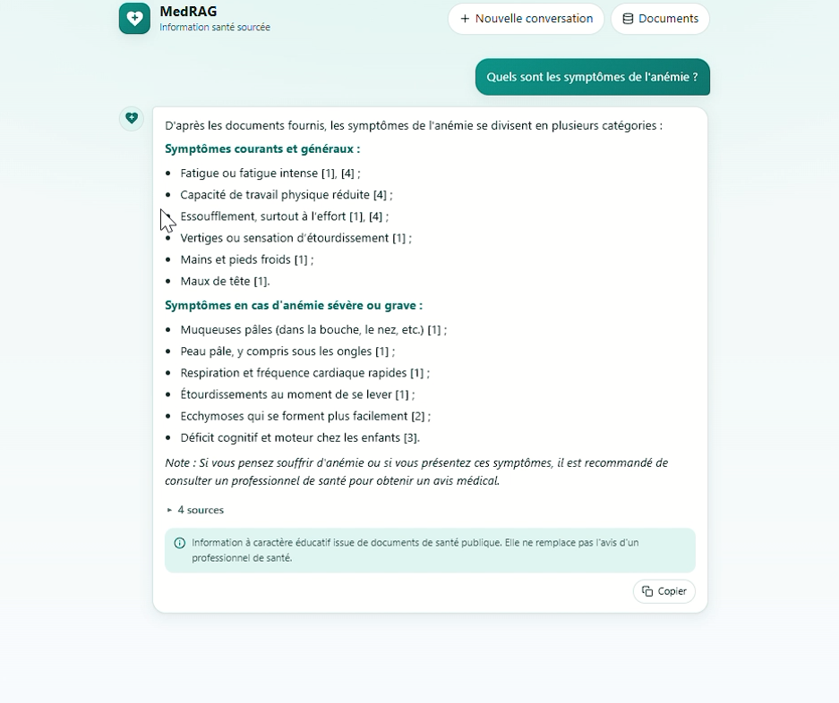
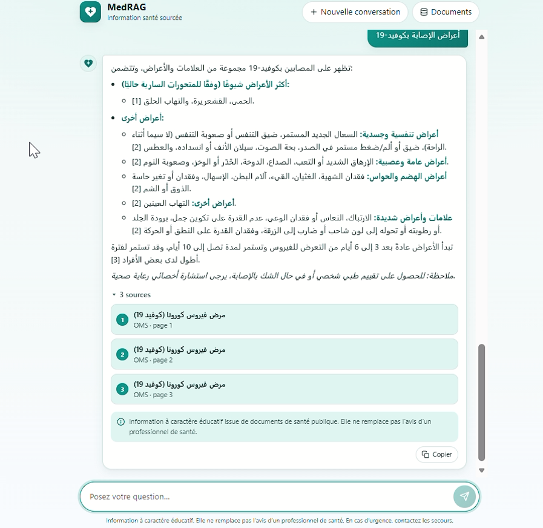
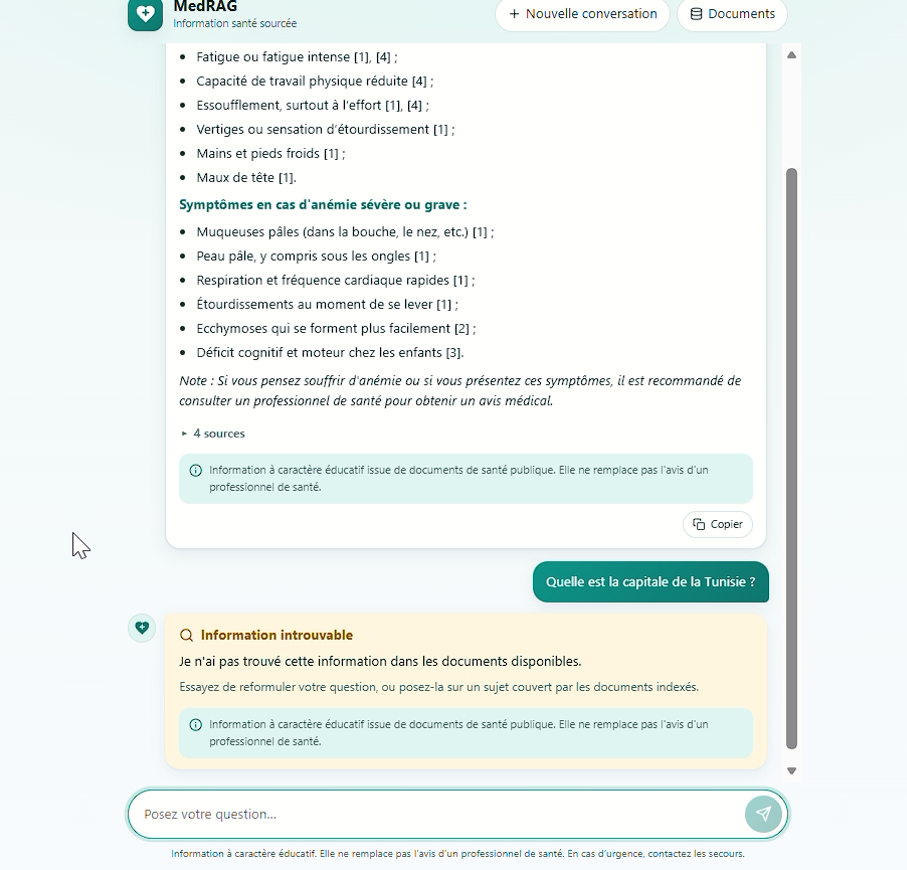
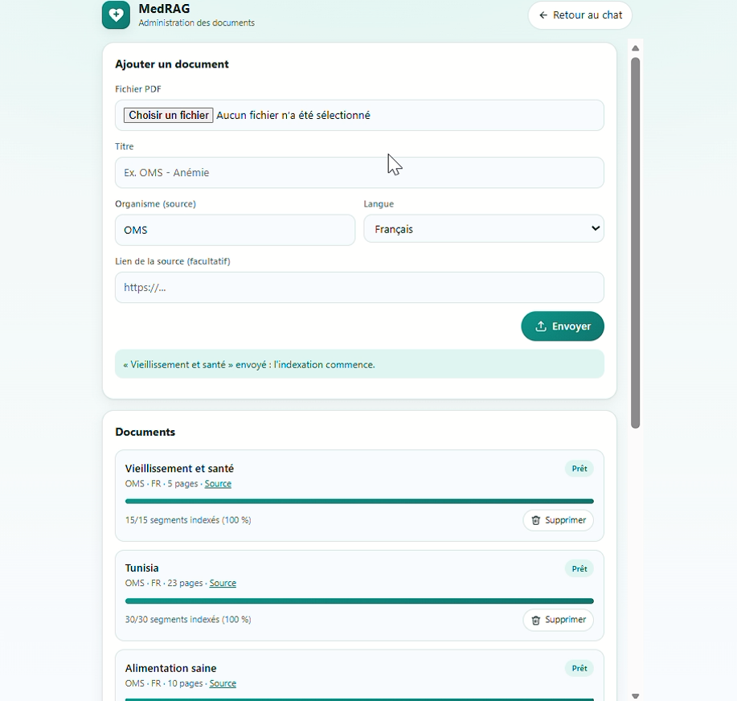
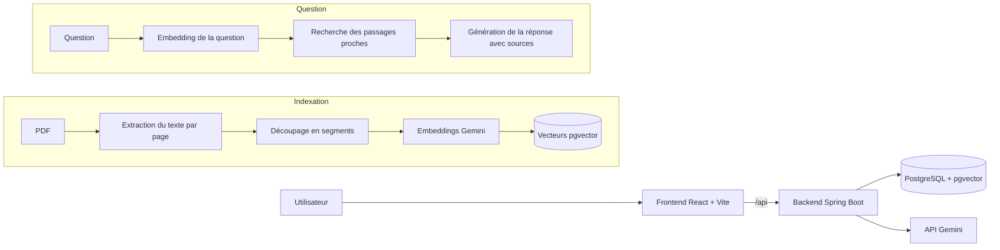

# MedRAG : assistant médical informatif

Assistant de questions-réponses en santé publique, fondé sur une approche **RAG** (*Retrieval-Augmented Generation*). Il répond **uniquement à partir de documents d'organismes de santé** (fiches, rapports) que l'on indexe, **cite ses sources** (document, organisme, page, lien) et **refuse de répondre** quand l'information n'est pas dans les documents.

> **Avertissement.** MedRAG fournit une information à caractère éducatif. Il ne remplace pas l'avis d'un professionnel de santé. En cas d'urgence, contactez les secours.

## Sommaire

1. [Démonstration](#démonstration)
2. [Fonctionnalités](#fonctionnalités)
3. [Architecture](#architecture)
4. [Technologies](#technologies)
5. [Prérequis](#prérequis)
6. [Installation et lancement](#installation-et-lancement)
7. [Utilisation](#utilisation)
8. [API REST](#api-rest)
9. [Configuration](#configuration)
10. [Structure du projet](#structure-du-projet)
11. [Tests](#tests)
12. [Choisir des documents fiables](#choisir-des-documents-fiables)
13. [Limites connues](#limites-connues)
14. [Pistes d'amélioration](#pistes-damélioration)


---

## Démonstration

### Réponse sourcée en français



### Réponse en arabe



### Question hors sujet (garde-fou)



### Ajout de documents



**Scénario de démo conseillé (environ 90 secondes) :**

| # | Action | Ce que la démo montre |
|---|---|---|
| 1 | Poser une question couverte par un document (ex. « Quels sont les symptômes de l'anémie ? ») | Réponse sourcée, avec document, organisme et page |
| 2 | Poser une question hors sujet (ex. « Quelle est la capitale de la Tunisie ? ») | Refus « Information introuvable » (garde-fou) |
| 3 | Ouvrir **Documents** et envoyer un nouveau PDF | Barre de progression de l'indexation |

---

## Fonctionnalités

**Chat**
- Réponses en français à partir des seuls documents indexés.
- Sources affichées pour chaque réponse (titre, organisme, page, lien cliquable).
- Garde-fou : « Information introuvable » si aucun passage pertinent n'est trouvé.
- Avertissement médical sur chaque réponse, copie de la réponse en un clic.

**Administration des documents**
- Envoi d'un PDF avec titre, organisme, langue et lien de la source.
- Détection des doublons par empreinte **SHA-256** du fichier (même sous un autre nom ou un autre titre).
- Indexation en arrière-plan avec **barre de progression** et rafraîchissement automatique.
- Statuts : `PENDING`, `INDEXING`, `READY`, `FAILED`.
- Boutons **Relancer** (documents en échec) et **Supprimer**.
- Reprise automatique des indexations interrompues au redémarrage du backend.

## Architecture



**Principe :**

1. **Indexation.** Le PDF est lu page par page, découpé en segments (800 caractères, chevauchement de 100), puis chaque segment est transformé en vecteur par Gemini et stocké dans PostgreSQL (pgvector).
2. **Question.** La question est transformée en vecteur ; les passages les plus proches sont retrouvés (4 au maximum, seuil de similarité de 0,65).
3. **Réponse.** Gemini rédige la réponse à partir de ces seuls passages, et l'interface affiche les sources. Sans passage pertinent, le système répond « Information introuvable ».

## Technologies

| Couche | Technologies |
|---|---|
| Frontend | React 19, Vite, `react-markdown` |
| Backend | Java 17, Spring Boot 4.1, Spring JDBC, Apache PDFBox 3 |
| Base de données | PostgreSQL 16 avec l'extension pgvector (Docker) |
| IA | API Gemini : modèle de chat, modèle de repli, embeddings `gemini-embedding-001` (768 dimensions) |

## Prérequis

- **Java 17** ou plus
- **Node.js** (version LTS récente) et npm
- **Docker Desktop**
- Une **clé d'API Gemini** (Google AI Studio)

## Installation et lancement

### 1. Cloner le dépôt

```bash
git clone <URL-DU-DEPOT>
cd medrag-project
```

### 2. Démarrer la base de données

```bash
docker compose up -d
```

La base `medrag` écoute sur le port **5433** (le port 5432 est souvent déjà pris par un PostgreSQL local). Le schéma est créé automatiquement au démarrage du backend (`schema.sql`).

### 3. Démarrer le backend

PowerShell (Windows) :

```powershell
cd backend
$env:GEMINI_API_KEY="votre_cle_ici"
.\mvnw.cmd spring-boot:run
```

Bash (macOS / Linux) :

```bash
cd backend
export GEMINI_API_KEY="votre_cle_ici"
./mvnw spring-boot:run
```

Le backend écoute sur `http://localhost:8080`. **Ne versionne jamais ta clé d'API** : elle ne se passe que par la variable d'environnement.

### 4. Démarrer le frontend

```bash
cd frontend
npm install
npm run dev
```

Ouvre l'adresse affichée (généralement `http://localhost:5173`). Vite redirige automatiquement `/api` vers le backend.

## Utilisation

1. Ouvre le bouton **Documents** et envoie un premier PDF (titre, organisme, langue, lien facultatif).
2. Attends le statut **Prêt** : la barre de progression indique les segments indexés.
3. Reviens au chat et pose une question sur le contenu du document.

## API REST

| Méthode | Route | Rôle | Réponses |
|---|---|---|---|
| `POST` | `/api/ask` | Poser une question (`{ "question": "…" }`) | 200 : `answer`, `answered`, `sources`, `disclaimer` |
| `GET` | `/api/search?q=…` | Voir les passages retrouvés (débogage) | 200 |
| `GET` | `/api/documents` | Lister les documents et leur progression | 200 |
| `POST` | `/api/documents` | Envoyer un PDF (formulaire : `file`, `title`, `organisme`, `sourceUrl`, `language`) | 201, 400, 409 (doublon), 422 (PDF illisible ou sans texte) |
| `POST` | `/api/documents/{id}/reindex` | Relancer l'indexation en arrière-plan | 202, 404, 409 (déjà en cours) |
| `POST` | `/api/documents/{id}/embeddings` | Indexation synchrone (dépannage) | 200 |
| `DELETE` | `/api/documents/{id}` | Supprimer un document et ses segments | 204, 404 |

## Configuration

Principaux réglages de `backend/src/main/resources/application.yml` :

| Clé | Valeur par défaut | Rôle |
|---|---|---|
| `app.gemini.api-key` | variable `GEMINI_API_KEY` | Clé d'API Gemini |
| `app.gemini.embedding-model` | `gemini-embedding-001` | Modèle d'embeddings |
| `app.gemini.embedding-dimensions` | `768` | Taille des vecteurs |
| `app.gemini.embedding-batch-size` | `20` | Segments envoyés par lot |
| `app.gemini.embedding-pause-ms` | `13000` | Pause entre deux lots (limite de débit) |
| `app.rag.chunk-size` | `800` | Taille d'un segment (caractères) |
| `app.rag.chunk-overlap` | `100` | Chevauchement entre segments |
| `app.rag.top-k` | `4` | Nombre de passages utilisés |
| `app.rag.similarity-threshold` | `0.65` | Seuil de pertinence |
| `server.error.include-message` | `always` | Renvoie le texte des erreurs au frontend |
| `spring.servlet.multipart.max-file-size` | `100MB` | Taille maximale d'un PDF |

## Structure du projet

```text
medrag-project/
├── backend/                     # API Spring Boot
│   └── src/main/
│       ├── java/tn/marah/medrag/
│       │   ├── api/             # Contrôleurs REST
│       │   └── service/         # Documents, découpage, embeddings, file d'indexation
│       └── resources/
│           ├── application.yml
│           └── schema.sql       # Tables documents et chunks
├── frontend/                    # Interface React + Vite
│   └── src/
│       ├── api.js               # Appels au backend
│       ├── App.jsx              # Chat et navigation
│       └── components/          # Message, Welcome, Admin, Icons
├── Scripts/medrag.ps1           # Fonctions PowerShell d'aide (envoi, questions)
├── docs/demo/                   # Démo : GIF, captures, miniature
├── docker-compose.yml           # Base PostgreSQL + pgvector
└── README.md
```

## Tests

Tests manuels dans le navigateur (page **Documents**) :

| Scénario | Résultat attendu |
|---|---|
| Envoyer un PDF valide | Message vert, statut « En attente » puis « Prêt » |
| Renvoyer le même PDF avec un autre titre | Message rouge de doublon, aucun nouveau document |
| Envoyer un PDF scanné (sans texte) | Refus : aucun texte trouvé |
| Envoyer un fichier corrompu ou non PDF | Refus avec un message explicite |
| Question couverte par un document | Réponse sourcée |
| Question hors sujet | « Information introuvable » |
| Supprimer un document puis reposer sa question | « Information introuvable » |

## Choisir des documents fiables

- Privilégier les organismes publics : **OMS** (publications sous licence CC BY-NC-SA 3.0 IGO pour celles parues après novembre 2016), ministères de la Santé, instituts nationaux (INSP en Tunisie), agences de santé publique.
- Utiliser des PDF dont le **texte est sélectionnable** (pas de scan).
- Renseigner l'**organisme** et le **lien de la source** à chaque envoi.
- Préférer des documents courts et ciblés, un sujet par document.
- Vérifier la licence de réutilisation avant de publier une base de documents.

## Limites connues

- Les PDF scannés ne sont pas lus (pas d'OCR).
- L'indexation est limitée par le débit de l'API Gemini : un long document peut prendre plusieurs minutes.
- Application éducative : la qualité des réponses dépend des documents indexés.

## Pistes d'amélioration

- OCR pour les documents scannés.
- Historique des conversations et évaluation des réponses.


